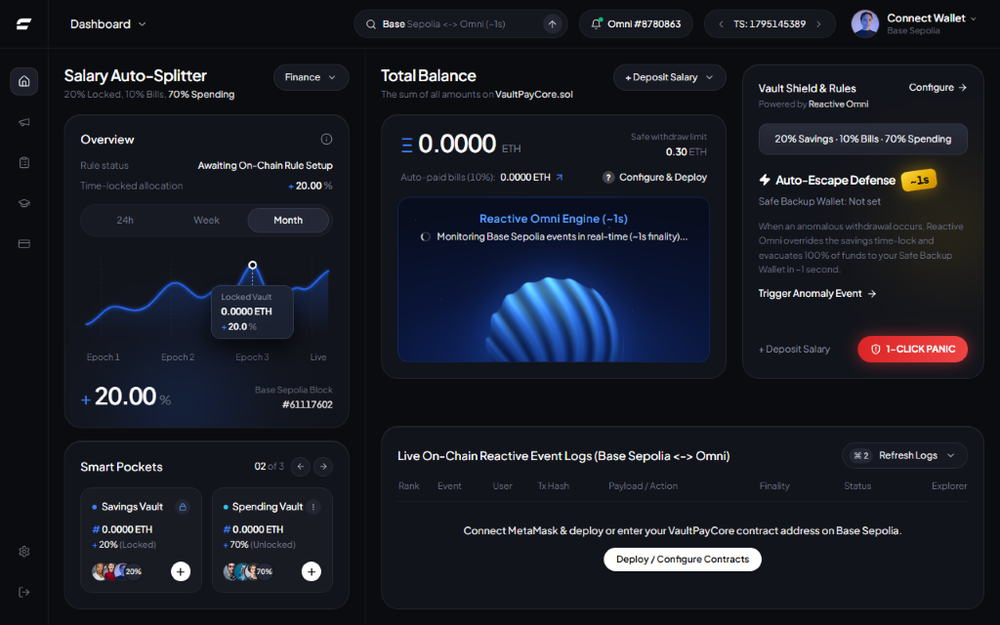
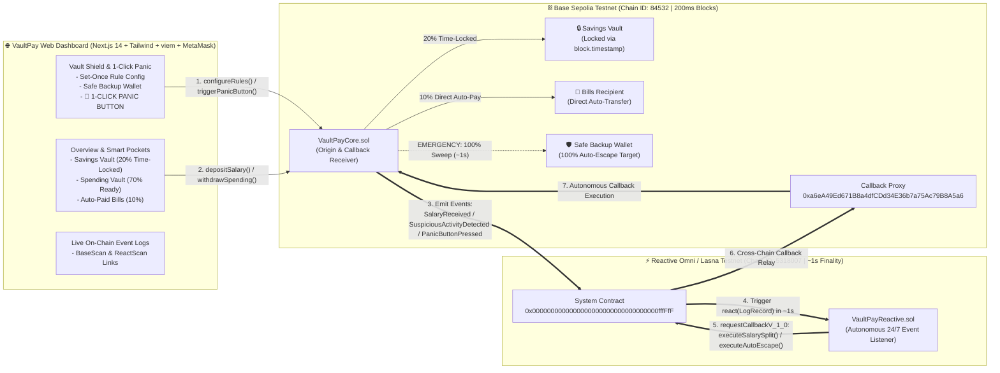
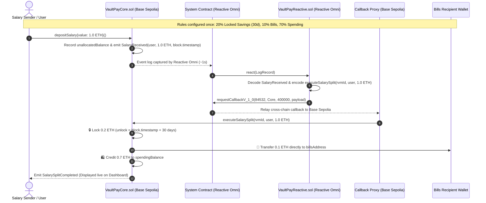
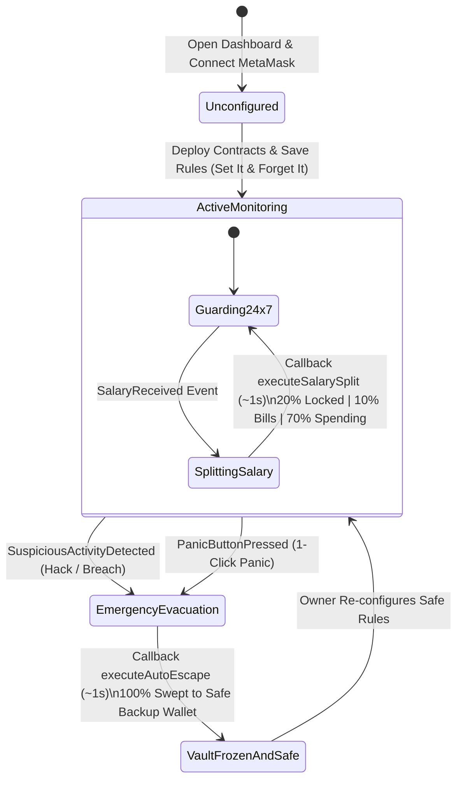
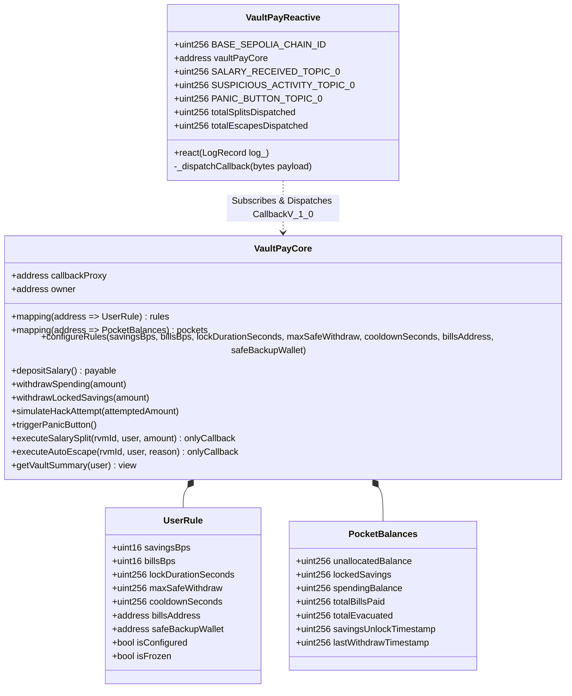

<div align="center">

# ⚡ VaultPay
### Autonomous Salary Auto-Splitter, Time-Locked Savings & 1-Second Anti-Hack Self-Evacuating Vault on Reactive Omni

[](https://dorahacks.io)
[](https://lasna.reactscan.net)
[](https://sepolia.basescan.org)
[](./contracts/src/VaultPayCore.sol)
[](./web/src/app/page.tsx)

*"Set your money rules once. Let Reactive Omni split your salary, lock your savings, pay your bills, and evacuate 100% of your funds in ~1 second if your wallet is ever compromised—with zero off-chain servers or keepers."*

[Architecture & Diagrams](#-system-architecture--diagrams) •
[3 Autonomous Loops](#️-3-autonomous-reactive-omni-loops) •
[Smart Contracts](#-smart-contract-specifications) •
[Project Structure](#-project-folder-structure) •
[Roadmap & Status](#-project-progress--roadmap) •
[Quick Start](#-quick-start--testnet-deployment)

</div>

---

## 🖥️ Live Web Dashboard Preview

VaultPay is built as a **100% Web Dashboard (Dark Bento Grid UI)** powered by live RPC telemetry from **Base Sepolia (`Chain ID: 84532`)** and **Reactive Omni / Lasna (`Chain ID: 5318007`)**, with native MetaMask one-click contract deployment, rule configuration, and real-time event log verification.



> 📄 **Full PRD, Architecture & Blueprint Document:** See [VaultPay_PRD_Architecture_Roadmap.md](./VaultPay_PRD_Architecture_Roadmap.md)

---

## 🎯 Problem Statement & Why Reactive Omni (~1s)

| Pain Point | Traditional Web3 Limitation | VaultPay + Reactive Omni Solution |
| :--- | :--- | :--- |
| **Manual Salary Budgeting & Impulse Spending** | Users manually split incoming salary across savings, bills, and spending wallets every payday—often overspending savings. | **Loop 1 (`Salary Auto-Splitter`):** Automatically locks **20% in Time-Locked Savings** (via `block.timestamp`), transfers **10% directly to `billsAddress`**, and leaves **70% in Spending Vault**. |
| **Slow Anti-Drain Protection (~7s+ or Off-Chain Bots)** | Previously, ~7s block times or fragile off-chain keeper bots were too slow to stop an active wallet drain or exploit. | **Loop 2 (`Auto-Escape Defense`):** With Reactive Omni's **~1s CometBFT finality**, `VaultPayReactive.sol` catches anomalies immediately, overrides the savings time-lock, and sweeps **100% of funds** to `safeBackupWallet`. |
| **No Instant Phishing Escape Hatch** | If a user realizes they signed a malicious approval or visited a phishing link, manually moving funds across pockets takes too long. | **Loop 3 (`1-Click Emergency Panic Button`):** One click on **`1-CLICK PANIC`** emits `PanicButtonPressed` and triggers immediate full-vault evacuation to safety. |

---

## ⚙️ 3 Autonomous Reactive Omni Loops

### 1. Autonomous Salary Splitter (`SalaryReceived` → `executeSalarySplit`)
- **Origin Event (Base Sepolia):** Any deposit to `depositSalary()` or `receive()` emits `SalaryReceived(user, amount, block.timestamp)`.
- **Reactive Brain (~1s):** `VaultPayReactive.sol` detects the event log and dispatches `requestCallbackV_1_0` targeting Base Sepolia (`84532`).
- **Callback Execution (Base Sepolia):** `VaultPayCore.executeSalarySplit()`:
  - Locks **20%** into `lockedSavings` until `block.timestamp + lockDurationSeconds` (e.g., 30 days).
  - Transfers **10%** directly to `billsAddress` (`totalBillsPaid`).
  - Credits **70%** to `spendingBalance` for daily transactions.

### 2. 1-Second Auto-Escape Defense (`SuspiciousActivityDetected` → `executeAutoEscape`)
- **Origin Event (Base Sepolia):** Triggered automatically when a withdrawal exceeds `maxSafeWithdraw`, violates the `block.timestamp` cooldown window, or attempts to breach `lockedSavings` before expiry (`withdrawLockedSavings`).
- **Reactive Brain (~1s):** `VaultPayReactive.sol` flags the threat (`"AUTO_HACK_DEFENSE"`) and dispatches an emergency evacuation callback.
- **Callback Execution (Base Sepolia):** `VaultPayCore.executeAutoEscape()` overrides the time-lock for emergency rescue, sweeps **100% of remaining funds** (`unallocated + lockedSavings + spendingBalance`) to `safeBackupWallet`, and freezes the compromised vault (`isFrozen = true`).

### 3. 1-Click Emergency Panic Button (`PanicButtonPressed` → `executeAutoEscape`)
- **Origin Event (Base Sepolia):** Clicking **`1-CLICK PANIC`** on the dashboard invokes `triggerPanicButton()`, emitting `PanicButtonPressed(user, totalBalanceAtRisk, block.timestamp)`.
- **Reactive Brain & Callback (~1s):** `VaultPayReactive.sol` immediately executes `executeAutoEscape(rvmId, user, "USER_PANIC_BUTTON")`, evacuating 100% of funds to `safeBackupWallet`.

> **Base Sepolia 200ms Block Rule Compliance:**  
> Because Base Sepolia produces blocks every **200ms**, all VaultPay timers, savings lock durations (`savingsUnlockTimestamp`), and withdrawal cooldown windows (`lastWithdrawTimestamp + cooldownSeconds`) strictly use **`block.timestamp` (UNIX seconds)** and never rely on `block.number`.

---

## 🏗️ System Architecture & Diagrams

### 1. High-Level Cross-Chain Architecture



---

### 2. Sequence Diagram — Loop 1: Autonomous Salary Split & Locked Savings



---

### 3. Sequence Diagram — Loop 2 & 3: Auto-Escape Defense & 1-Click Panic Button

```mermaid
sequenceDiagram
    autonumber
    actor Actor as Attacker / User (Panic Click)
    participant Core as VaultPayCore.sol (Base Sepolia)
    participant Sys as System Contract (Reactive Omni)
    participant Brain as VaultPayReactive.sol (Reactive Omni)
    participant Proxy as Callback Proxy (Base Sepolia)
    participant Safe as 🛡️ Safe Backup Wallet

    alt Loop 2: Compromised Key / Anomaly
        Actor->>Core: withdrawSpending(0.8 ETH) [Exceeds 0.3 ETH maxSafeWithdraw]
        Core->>Core: Block transfer & emit SuspiciousActivityDetected(user, 0.8 ETH, block.timestamp)
    else Loop 3: 1-Click Emergency Panic
        Actor->>Core: triggerPanicButton()
        Core->>Core: Emit PanicButtonPressed(user, totalBalanceAtRisk, block.timestamp)
    end

    Core-->>Sys: Threat signal captured by Reactive Omni (~1s)
    Sys->>Brain: react(LogRecord)
    Brain->>Sys: requestCallbackV_1_0(84532, Core, 400000, executeAutoEscape)
    Sys-->>Proxy: Relay emergency callback (~1s CometBFT finality)
    Proxy->>Core: executeAutoEscape(rvmId, user, reason)
    Core->>Core: 🔓 Override savings time-lock & zero all balances (CEI)
    Core->>Safe: 🚀 Sweep 100% of total funds (Locked + Spending) to Safe Backup Wallet
    Core->>Core: 🔒 Freeze compromised vault (isFrozen = true)
```

---

### 4. State Machine — Vault Security Lifecycle



---

### 5. Smart Contract Class Diagram



---

## 🛠️ Smart Contract Specifications & Network Parameters

| Parameter | Base Sepolia (Money & Vaults) | Reactive Omni / Lasna (Autonomous Brain) |
| :--- | :--- | :--- |
| **Network Name** | Base Sepolia Testnet | Reactive Lasna Testnet (Omni Consensus) |
| **Chain ID** | `84532` | `5318007` |
| **RPC Endpoint** | `https://sepolia.base.org` | `https://lasna-rpc.rnk.dev/` |
| **Block Time** | ~200ms *(Strictly uses `block.timestamp`)* | ~1.0s *(Instant CometBFT Finality)* |
| **System / Proxy** | Callback Proxy: `0xa6eA49Ed671B8a4dfCDd34E36b7a75Ac79B8A5a6` | System Contract: `0x0000000000000000000000000000000000fffFfF` |
| **Block Explorer** | `https://sepolia.basescan.org` | `https://lasna.reactscan.net` |

---

## 📁 Project Folder Structure

```text
Vaultpay/
├── .env.example                                  # Environment variables template (RPCs, keys, contract addresses)
├── .gitignore                                    # Ignores node_modules, .next, and sensitive .env files
├── README.md                                     # Main project documentation & DoraHacks judge guide
├── VaultPay_PRD_Architecture_Roadmap.md          # Complete PRD, technical specs & roadmap
├── docs/
│   └── dashboard-preview.png                     # Live Dark Bento Grid Web Dashboard preview
│
├── contracts/                                    # Solidity Smart Contracts (solc 0.8.24 + Foundry)
│   ├── foundry.toml                              # Compiler & multi-chain RPC configuration
│   ├── deploy-and-prove.mjs                      # Automated viem deployer + 3-loop on-chain proof runner
│   ├── out/                                      # Compiled ABI & EVM bytecode artifacts (solc 0.8.24)
│   ├── src/
│   │   ├── VaultPayCore.sol                      # Base Sepolia vault: Salary Split, Time-Lock, Auto-Escape & Panic
│   │   ├── VaultPayReactive.sol                  # Reactive Omni contract: 3-event subscription & CallbackV_1_0
│   │   └── interfaces/
│   │       └── IVaultPay.sol                     # Shared structs, events, IReactive & ISystemContract interfaces
│   ├── script/
│   │   ├── DeployBase.s.sol                      # Foundry script to deploy VaultPayCore to Base Sepolia
│   │   ├── DeployReactive.s.sol                  # Foundry script to deploy VaultPayReactive to Reactive Omni
│   │   └── RunFullDemoProof.s.sol                # Foundry script to execute all 3 autonomous workflows
│   └── test/
│       └── VaultPay.t.sol                        # End-to-end unit tests (Split, Escape, Panic, block.timestamp)
│
└── web/                                          # Next.js 14 + Tailwind CSS + viem Web Dashboard
    ├── package.json
    └── src/
        ├── app/
        │   ├── globals.css                       # Dark matte theme, tabular-nums & custom scrollbars
        │   ├── layout.tsx                        # Root metadata & dark mode layout
        │   └── page.tsx                          # Main full-screen Bento Grid dashboard & on-chain modal
        ├── components/
        │   ├── Navbar.tsx                        # Top bar + Live Omni/Base block telemetry + MetaMask connect
        │   ├── OverviewChartCard.tsx             # Allocation chart, rule status & live Base Sepolia block
        │   ├── SmartPocketsCard.tsx              # Savings Vault (Locked) & Spending Vault (Unlocked)
        │   ├── TotalBalanceCard.tsx              # Live contract balance, auto-paid bills & deposit trigger
        │   ├── ReactiveEngineCard.tsx            # 3D Swirled Cobalt Sphere Canvas & real-time engine status
        │   ├── SwirledOrbCanvas.tsx              # Custom procedural 3D cobalt-blue ribbed orb renderer
        │   ├── RuleAndPanicCard.tsx              # Set-Once rule summary, Auto-Escape ~1s & 1-CLICK PANIC
        │   └── LiveProofTable.tsx                # Live BaseScan & ReactScan event log table
        └── lib/
            ├── contracts.ts                      # Compiled ABIs, bytecodes & official network constants
            └── wagmi.ts                          # viem RPC readers, MetaMask deployer & write contract calls
```

---

## 📊 Project Progress & Roadmap

| Phase | Milestone | Status | Details |
| :--- | :--- | :---: | :--- |
| **Phase 1** | Concept, PRD & System Architecture | ✅ **Done** | Locked track (`Set It and Forget It`), defined 3 autonomous loops, 5 Mermaid diagrams, and 200ms `block.timestamp` compliance. |
| **Phase 2** | Dark Bento Grid Web Dashboard (`web/`) | ✅ **Done** | Built full-screen Next.js 14 dashboard with custom 3D Swirled Cobalt Sphere canvas, 100% English UI, and live RPC polling (`Base Sepolia` + `Reactive Omni`). |
| **Phase 3** | Smart Contracts & `viem` Integration (`contracts/`) | ✅ **Done** | Implemented & compiled (`solc 0.8.24`) `VaultPayCore.sol`, `VaultPayReactive.sol`, `IVaultPay.sol`, Foundry scripts/tests, and MetaMask 1-click deployment + execution. |
| **Phase 4** | Live Testnet Deployment & On-Chain Proof | ⏳ **Ready** | Fund wallet with Base Sepolia `ETH` & Lasna `lREACT`, then deploy directly via the Web UI or `node contracts/deploy-and-prove.mjs` to auto-populate the hashes below. |
| **Phase 5** | DoraHacks Submission & Video Demo (< 3m) | ⏳ **Pending** | Record < 3-minute live walkthrough showing all 3 loops on-chain and submit repository + proofs before **December 5, 2026**. |

---

## 🔗 Deployed Contracts & On-Chain Proof (For Judges)

| Contract | Network | Chain ID | Deployed Address |
| :--- | :--- | :---: | :--- |
| **`VaultPayCore.sol`** | Base Sepolia | `84532` | `0xYOUR_BASE_SEPOLIA_ADDRESS` |
| **`VaultPayReactive.sol`** | Reactive Omni (Lasna) | `5318007` | `0xYOUR_REACTIVE_OMNI_ADDRESS` |

### Proof 1: Salary Auto-Split & Time-Locked Savings Loop
- **Origin Deposit Tx (Base Sepolia):** `0xORIGIN_TX_1`
- **Reactive Transaction (Reactive Omni):** `0xREACTIVE_TX_1`
- **Callback Split Tx (Base Sepolia):** `0xCALLBACK_TX_1`

### Proof 2: Auto-Escape Defense / 1-Click Panic Evacuation Loop
- **Origin Anomaly / Panic Tx (Base Sepolia):** `0xORIGIN_TX_2`
- **Reactive Transaction (Reactive Omni):** `0xREACTIVE_TX_2`
- **Callback Evacuation Tx (Base Sepolia):** `0xCALLBACK_TX_2`

---

## 🚀 Quick Start & Testnet Deployment

### 1. Run the Live Web Dashboard Locally
```bash
git clone https://github.com/panzauto46-bot/Vaultpay.git
cd Vaultpay/web
npm install
npm run dev
```
Open **[http://localhost:3000](http://localhost:3000)** in your browser. Click **`Connect Wallet`** to link MetaMask to Base Sepolia, then click **`Deploy / Configure Contracts`** to deploy `VaultPayCore.sol` and `VaultPayReactive.sol` directly from your browser.

### 2. Deploy & Run All 3 Loops via Automated Script (`viem` + `solc 0.8.24`)
Ensure your wallet holds testnet **Base Sepolia ETH** and **Reactive Lasna `lREACT`**, then execute:
```powershell
cd Vaultpay
$env:PRIVATE_KEY="0xYOUR_PRIVATE_KEY"
node contracts/deploy-and-prove.mjs
```
This script automatically:
1. Deploys `VaultPayCore.sol` to **Base Sepolia (`84532`)** and `VaultPayReactive.sol` to **Reactive Omni (`5318007`)**.
2. Executes `configureRules`, `depositSalary`, `simulateHackAttempt`, and `triggerPanicButton`.
3. Writes deployed contract addresses into `web/.env.local` and updates the proof table in this `README.md`.

### 3. Compile & Test with Foundry (Optional)
```bash
cd contracts
forge build
forge test -vvv
```
