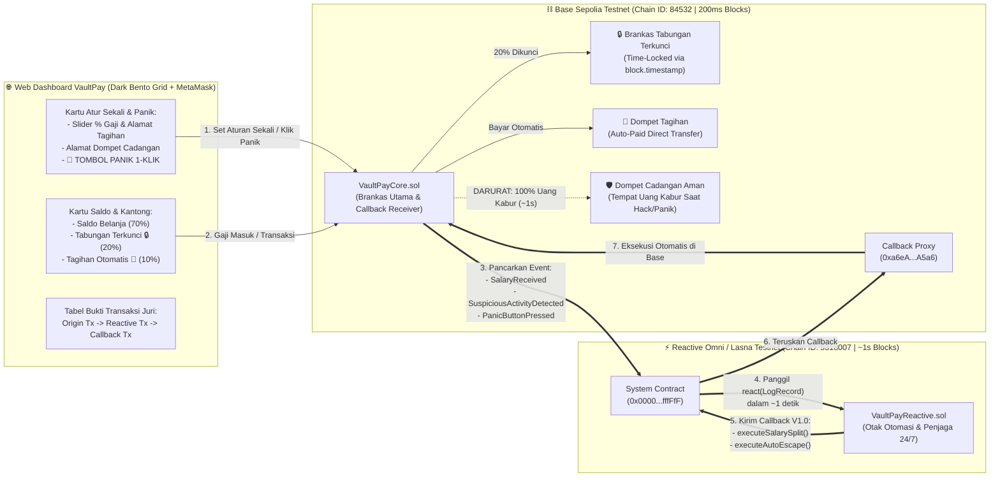
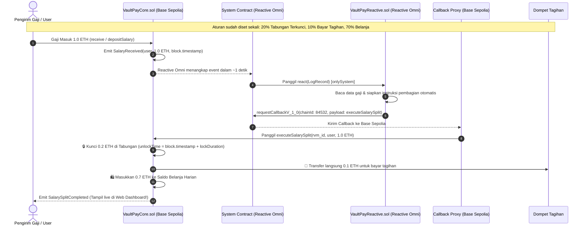
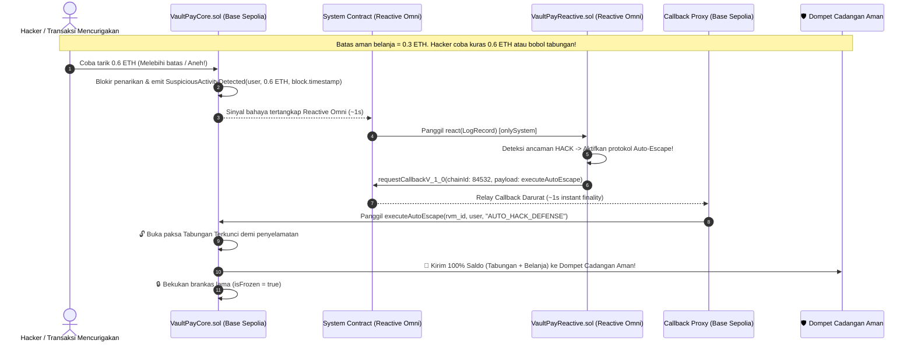
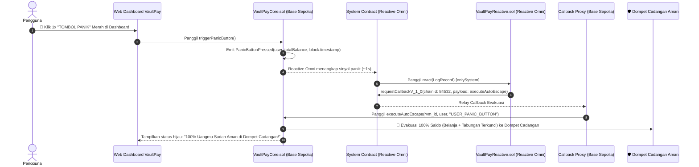
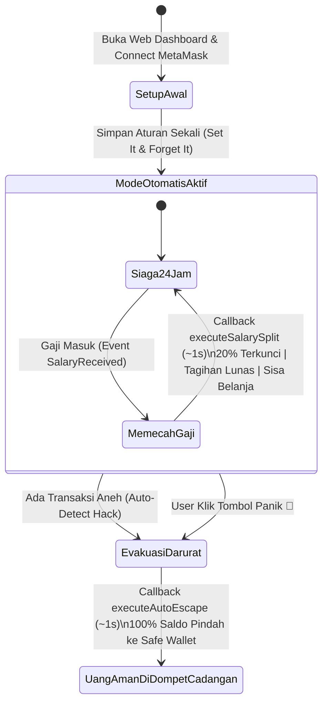

# VaultPay — Autonomous Salary Splitter, Locked Savings & 1s Anti-Hack Dashboard on Reactive Omni

> **Track Lomba:** `Set It and Forget It` — Reactive Omni Buildathon ($5,500 Prize Pool)  
> **Platform:** **100% Web Dashboard (Dark Bento Grid Web App)** — Tanpa mockup HP, langsung dibuka di browser dan terhubung ke MetaMask.  
> **3 Fitur Utama:**  
> 1. **Gaji masuk, langsung terbagi otomatis:** 20% masuk tabungan yang terkunci, sebagian langsung bayar tagihan, sisanya buat belanja. Atur sekali di awal, habis itu tidak perlu diapa-apakan.  
> 2. **Kalau dompet kena hack, uangmu kabur sendiri:** Begitu ada yang aneh, semua saldo langsung pindah ke dompet cadangan yang aman dalam ~1 detik — tanpa kamu klik apa-apa.  
> 3. **Tombol Panik 1-Klik:** Satu klik tombol darurat di dashboard, semua uang langsung diamankan detik itu juga.  
> **Target Jaringan:** Base Sepolia (Chain ID: `84532` - 200ms blocks) ↔ Reactive Omni / Lasna Testnet (Chain ID: `5318007` - ~1s blocks)

---

## Daftar Isi
1. [Bagian 1: Product Requirements Document (PRD)](#1-product-requirements-document-prd)
2. [Bagian 2: Arsitektur Sistem & 5 Diagram Lengkap](#2-arsitektur-sistem--5-diagram-lengkap)
3. [Bagian 3: Spesifikasi Smart Contract & Kepatuhan Aturan Lomba](#3-spesifikasi-smart-contract--kepatuhan-aturan-lomba)
4. [Bagian 4: Blueprint Desain UI Web Dashboard (Dark Bento Grid)](#4-blueprint-desain-ui-web-dashboard-dark-bento-grid)
5. [Bagian 5: Struktur Folder & Arsitektur Kode Proyek](#5-struktur-folder--arsitektur-kode-proyek)
6. [Bagian 6: Roadmap Pengerjaan & Progress Tracker](#6-roadmap-pengerjaan--progress-tracker)
7. [Bagian 7: Template README.md (Siap Pakai untuk Submit ke Juri)](#7-template-readmemd-siap-pakai-untuk-submit-ke-juri)

---

## 1. Product Requirements Document (PRD)

### 1.1 Masalah Nyata yang Diselesaikan (Problem Statement)
1. **Capek Bagi Gaji & Bayar Tagihan Manual Tiap Bulan:** Setiap kali terima gaji/pembayaran di dompet crypto, pengguna harus repot transfer manual ke akun tabungan, kirim uang ke tempat bayar tagihan, dan sering kali uang tabungannya malah terpakai belanja karena tidak dikunci.
2. **Saat Dompet Kena Hack, Pengguna Selalu Kalah Cepat:** Ketika dompet terkena *phishing* atau *drain*, pencuri menguras saldo dalam hitungan detik. Sebelum adanya Reactive Omni (~1 detik blok), sistem pertahanan otomatis masih terlalu lambat (~7 detik).
3. **Tidak Ada Tombol Darurat Instan (Panic Button):** Saat pengguna sadar baru saja mengklik link berbahaya atau menandatangani transaksi mencurigakan, tidak ada tombol darurat 1-klik yang bisa langsung memindahkan seluruh aset (termasuk tabungan yang sedang terkunci) ke dompet cadangan yang aman.

---

### 1.2 Tiga Fitur Utama VaultPay (Core Value Proposition)

#### Fitur 1: Auto-Split Gaji & Tabungan Terkunci (*Set Once, Forget Forever*)
* Pengguna mengatur aturan **1 kali saja di awal** lewat Web Dashboard:
  * **20% → Tabungan Terkunci (`Locked Savings`):** Saldo ini otomatis masuk ke brankas tabungan dan **terkunci menggunakan `block.timestamp`** (misal terkunci selama 30 hari) sehingga tidak bisa terpakai belanja impulsif.
  * **10% (atau sesuai aturan) → Langsung Bayar Tagihan (`Auto-Pay Bills`):** Otomatis langsung ditransfer ke alamat dompet tagihan/langganan (`billsAddress`) tanpa perlu klik bayar lagi.
  * **70% (Sisanya) → Saldo Belanja (`Spending Balance`):** Siap digunakan untuk transaksi sehari-hari.
* Setiap ada uang/gaji masuk ke kontrak di Base Sepolia, event `SalaryReceived` terpancar → **Reactive Omni** menangkapnya dalam ~1 detik → mengirim *callback* `executeSalarySplit()` yang langsung memecah dan membayarkan semuanya secara otomatis.

#### Fitur 2: Uang Kabur Sendiri Saat Kena Hack (*1-Second Self-Evacuating Wallet*)
* Pengguna mendaftarkan 1 alamat **Dompet Cadangan Aman (`safeBackupWallet`)** dan **Batas Wajar Penarikan (`maxSafeWithdraw`)**.
* Begitu ada aktivitas mencurigakan di dompet (misalnya percobaan penarikan melebihi batas wajar, atau percobaan membobol tabungan yang sedang terkunci), kontrak memancarkan event `SuspiciousActivityDetected`.
* Dalam **~1 detik**, Reactive Omni menangkap sinyal bahaya tersebut dan menembakkan *callback* `executeAutoEscape()` yang **membuka paksa kunci tabungan dan melarikan 100% uang (Saldo Belanja + Tabungan Terkunci)** ke **Dompet Cadangan Aman** — tanpa pengguna perlu klik apa-apa!

#### Fitur 3: Tombol Panik 1-Klik (*1-Click Emergency Panic Button*)
* Di halaman Web Dashboard VaultPay, terdapat **Tombol Panik Darurat (`PANIC: AMANKAN SEMUA UANG`)**.
* Jika pengguna merasa dompetnya dalam bahaya (misal habis salah klik web *scam*), cukup **1 klik**:
  * Fungsi `triggerPanicButton()` memancarkan event `PanicButtonPressed`.
  * Reactive Omni langsung memicu *callback* evakuasi darurat dalam ~1 detik untuk memindahkan seluruh saldo ke Dompet Cadangan Aman dan mengunci brankas lama.

---

### 1.3 Strategi Menang di 4 Kriteria Juri (Judging Matrix)

| Kriteria Juri (Bobot 25%) | Bagaimana VaultPay Mendapat Nilai Penuh (5/5) |
| :--- | :--- |
| **1. Execution (Berjalan di On-Chain)** | Semua 3 skenario (*Gaji Masuk*, *Kena Hack Otomatis Kabur*, dan *Tombol Panik*) berjalan nyata di **Base Sepolia** & **Reactive Omni Testnet**, menghasilkan 3 rangkaian **Tx Hash** (*Origin Event → Reactive Tx → Callback Tx*). |
| **2. Integration (Peran Nyata Reactive)** | Reactive Omni adalah **otak utama**: tanpa Reactive Contract, gaji yang masuk tidak akan terpecah/terbayar otomatis, dan sinyal bahaya/tombol panik tidak bisa memicu penyelamatan lintas-kontrak secara otonom. |
| **3. Usefulness (Kegunaan Nyata)** | Sangat membumi dan langsung dipahami siapa saja dalam 5 detik: *"Gaji otomatis dibagi & ditabung, kalau kena hack uang kabur sendiri, plus ada tombol panik 1-klik."* |
| **4. Craft (Kualitas UI, Kode & Demo)** | Tampilan **Web Dashboard Dark Bento Grid** yang elegan (sesuai referensi gambar Pinterest), patuh aturan `block.timestamp` Base Sepolia 200ms, dan punya tabel bukti on-chain langsung di bagian bawah dashboard. |

---

## 2. Arsitektur Sistem & 5 Diagram Lengkap

### 2.1 Diagram Arsitektur Utama (High-Level Cross-Chain Flow)



---

### 2.2 Sequence Diagram 1: Gaji Masuk → Otomatis Terbagi, Terkunci & Bayar Tagihan



---

### 2.3 Sequence Diagram 2: Dompet Kena Hack → Uang Kabur Sendiri (~1 Detik)



---

### 2.4 Sequence Diagram 3: Tombol Panik 1-Klik → Semua Uang Langsung Diamankan



---

### 2.5 State Diagram: Status Keamanan Dompet & Tabungan



---

## 3. Spesifikasi Smart Contract & Kepatuhan Aturan Lomba

### 3.1 Konfigurasi Jaringan Resmi

| Parameter | Base Sepolia (Tempat Uang & Brankas) | Reactive Omni / Lasna (Otak Otomasi ~1s) |
| :--- | :--- | :--- |
| **Chain ID** | `84532` | `5318007` |
| **RPC URL** | `https://sepolia.base.org` | `https://lasna-rpc.rnk.dev/` |
| **Kecepatan Blok** | **200ms** *(Wajib pakai `block.timestamp`)* | **~1 detik** *(Instant CometBFT Finality)* |
| **Alamat Kontrak Sistem** | Callback Proxy: `0xa6eA49Ed671B8a4dfCDd34E36b7a75Ac79B8A5a6` | System Contract: `0x0000000000000000000000000000000000fffFfF` |
| **Explorer** | `https://sepolia.basescan.org` | `https://lasna.reactscan.net` |

### 3.2 Aturan Wajib Base Sepolia 200ms (`block.timestamp`)
Sesuai aturan resmi lomba (*Ground Rules*):
> *"Base Sepolia now produces blocks every 200ms, so use timestamps rather than block counts for any timers, cooldowns, or deadlines there."*

Di dalam `VaultPayCore.sol`, semua timer menggunakan **detik waktu nyata (`block.timestamp`)**:
1. **Timer Kunci Tabungan 20%:**  
   `pocket.savingsUnlockTimestamp = block.timestamp + rule.lockDurationSeconds;`  
   Selama `block.timestamp < pocket.savingsUnlockTimestamp`, tabungan tidak bisa ditarik manual untuk belanja (tetapi **bisa diselamatkan otomatis** oleh callback `executeAutoEscape` jika dompet kena hack atau Tombol Panik ditekan!).
2. **Jendela Deteksi Transaksi Aneh (Cooldown & Rate-Limit):**  
   Menggunakan selisih detik `block.timestamp - lastWithdrawTimestamp` untuk mendeteksi penarikan beruntun yang mencurigakan.

---

## 4. Blueprint Desain UI Web Dashboard (Dark Bento Grid)

Tampilan aplikasi adalah **100% Web Dashboard murni** (tanpa mockup HP) dengan tata letak **Dark Bento Grid** sesuai gambar referensi yang kamu pilih di Pinterest: latar belakang hitam *matte* (`#0A0B0E`), kartu gelap elegan (`#12141A`), aksen **Reactive Electric Blue (`#2563EB`)**, dan **Tombol Panik Merah (`#EF4444`)**.

### 4.1 Tata Letak 3 Kolom Bento Grid di Browser Web

```text
========================================================================================================
 ⚡ VaultPay   [Dashboard]            🟢 Base Sepolia (200ms) <-> Reactive Omni (~1s)   [Connect Wallet]
========================================================================================================

+----------------------------------+ +----------------------------------+ +----------------------------+
| 1. OVERVIEW & GRAFIK ALOKASI     | | 3. TOTAL SALDO BRANKAS           | | 5. ATUR SEKALI & PANIK     |
|                                  | | $ 4,250.00 (1.50 ETH)            | |                            |
| [Grafik Pertumbuhan Tabungan]    | | "Dijaga otomatis 24/7 oleh Omni" | | - Tabungan Terkunci : 20%  |
|                                  | | [ + Deposit / Simulasi Gaji ]    | | - Bayar Tagihan     : 10%  |
| Status Aturan:                   | +----------------------------------+ | - Saldo Belanja     : 70%  |
| "Set It & Forget It — AKTIF"     | +----------------------------------+ | - Dompet Cadangan   : 0x.. |
+----------------------------------+ | 4. REACTIVE OMNI ENGINE (~1s)    | | [ Simpan Aturan Sekali ]   |
+----------------------------------+ |    (Visual Bola Biru Menyala)    | |----------------------------|
| 2. KANTONG OTOMATIS              | |                                  | | 🚨 TOMBOL PANIK DARURAT    |
| +--------------+ +-------------+ | | "Memantau event gajian & bahaya  | | [ AMANKAN SEMUA UANG 1-KLIK|
| |🔒 TABUNGAN   | |🛍️ BELANJA   | | |  secara real-time (~1s block)..."| |                            |
| |20% Terkunci  | |70% Siap Pakai| | +----------------------------------+ | [ 🕵️ Simulasi Kena Hack ]  |
| |0.30 ETH      | |1.05 ETH     | | +----------------------------------+ +----------------------------+
| +--------------+ +-------------+ | | 🧾 TAGIHAN OTOMATIS (10%) : ✅ Otomatis Terbayar ke 0x99B...21C |
+----------------------------------+ +-----------------------------------------------------------------+

+------------------------------------------------------------------------------------------------------+
| 6. LIVE REACTIVE TRANSACTION LOOP (TABEL BUKTI ON-CHAIN UNTUK JURI)                                  |
| Waktu   | Kejadian                 | Origin Tx (Base) | Reactive Tx (Omni) | Callback Tx (Base)      |
|---------|--------------------------|------------------|--------------------|-------------------------|
| Baru aja| 💰 Gaji Masuk -> Dibagi  | 0x8a3f... [Lihat]| 0x4c1d... [Lihat]  | 0x9f2a... [Sukses ~1s]  |
| 2m lalu | 🛡️ Kena Hack -> Kabur    | 0x1b4e... [Lihat]| 0x7e2c... [Lihat]  | 0x5d8b... [Aman 100%]   |
+------------------------------------------------------------------------------------------------------+
```

### 4.2 Detail 6 Kartu di Web Dashboard
1. **Kartu Kiri Atas (Overview & Grafik):** Menampilkan grafik riwayat gaji masuk dan pertumbuhan tabungan otomatis.
2. **Kartu Kiri Bawah (Kantong Otomatis):** Menampilkan 2 kartu berdampingan: **🔒 Tabungan Terkunci (20%)** (lengkap dengan sisa waktu kunci `block.timestamp`) dan **🛍️ Saldo Belanja (70%)**.
3. **Kartu Tengah Atas (Total Balance):** Menampilkan total saldo di brankas + tombol **Simulasi Gaji Masuk**.
4. **Kartu Tengah Bawah (Bola Biru Reactive Omni Core + Status Tagihan):** Visual bola biru 3D yang berdenyut saat Reactive Omni memproses callback (~1 detik) + baris status **🧾 Tagihan Otomatis (10%) Lunas**.
5. **Kartu Kanan (Atur Sekali & 🚨 Tombol Panik 1-Klik):**
   * Form pengaturan pembagian gaji (20% Tabungan, 10% Tagihan, 70% Belanja) dan alamat **Dompet Cadangan Aman**.
   * **Tombol Panik Merah Besar (`AMANKAN SEMUA UANG`)** + tombol **Simulasi Kena Hack** untuk pengujian juri.
6. **Tabel Bawah (Live Reactive Transaction Loop):** Tabel bukti transaksi lengkap (`Origin Tx` → `Reactive Omni Tx` → `Callback Tx`) dengan link langsung ke Block Explorer.

---

## 5. Struktur Folder & Arsitektur Kode Proyek

Seluruh proyek ditempatkan di `D:\Coding\Vaultpay`:

```text
D:\Coding\Vaultpay\
├── README.md                                  # Dokumentasi utama bahasa Inggris untuk Juri DoraHacks
├── VaultPay_PRD_Architecture_Roadmap.md       # Dokumen PRD, Diagram, UI Web Bento Grid, & Roadmap ini
├── .env.example                               # Template variabel RPC & Private Key untuk deploy
│
├── contracts/                                 # Folder Smart Contract (Solidity / Foundry)
│   ├── foundry.toml                           # Konfigurasi compiler Solidity & library @reactive
│   ├── src/
│   │   ├── VaultPayCore.sol                   # Kontrak Brankas di Base Sepolia (Gaji, Kunci 20%, Escape, Panik)
│   │   ├── VaultPayReactive.sol               # Kontrak Otak di Reactive Omni (~1s Event Listener & Callback)
│   │   └── interfaces/
│   │       └── IVaultPay.sol                  # Interface event & struct
│   ├── script/
│   │   ├── DeployBase.s.sol                   # Script deploy VaultPayCore.sol ke Base Sepolia
│   │   ├── DeployReactive.s.sol               # Script deploy VaultPayReactive.sol ke Reactive Omni
│   │   └── RunFullDemoProof.s.sol             # Script pemicu 3 skenario untuk menghasilkan Tx Hash lomba
│   └── test/
│       └── VaultPay.t.sol                     # Unit test: Gaji Masuk, Tabungan Terkunci, Auto-Escape, Tombol Panik
│
└── web/                                       # Folder Web Dashboard (Next.js + Tailwind CSS)
    ├── package.json
    └── src/
        ├── app/
        │   ├── layout.tsx                     # Tema Dark Bento Grid & Web3 Provider
        │   └── page.tsx                       # Halaman Utama Web Dashboard VaultPay
        ├── components/
        │   ├── Navbar.tsx                     # Top Bar + Status Jaringan + Connect MetaMask
        │   ├── OverviewChartCard.tsx          # Kartu Kiri Atas: Grafik Alokasi Gaji & Tabungan
        │   ├── SmartPocketsCard.tsx           # Kartu Kiri Bawah: Tabungan Terkunci 20% & Saldo Belanja 70%
        │   ├── TotalBalanceCard.tsx           # Kartu Tengah Atas: Total Saldo & Simulasi Gaji Masuk
        │   ├── ReactiveEngineCard.tsx         # Kartu Tengah Bawah: Bola Biru Reactive Omni ~1s & Status Tagihan
        │   ├── RuleAndPanicCard.tsx           # Kartu Kanan: Form Atur Sekali + Tombol Panik Merah 1-Klik
        │   └── LiveProofTable.tsx             # Tabel Bawah: Bukti Origin Tx -> Reactive Omni -> Callback Tx
        └── lib/
            ├── contracts.ts                   # ABI & Alamat Kontrak yang sudah di-deploy
            └── wagmi.ts                       # Konfigurasi koneksi MetaMask ke Base Sepolia & Reactive Lasna
```

---

## 6. Roadmap Pengerjaan & Progress Tracker

Daftar langkah kerja (*checklist*) sampai siap dikumpulkan ke DoraHacks:

### Fase 1: Konsep, PRD & Desain Arsitektur (SELESAI ✅)
- [x] Memilih Track lomba: **Set It and Forget It** ($2,000 Prize Pool).
- [x] Mengunci nama aplikasi: **VaultPay**.
- [x] Mengunci 3 fitur utama:
  - [x] **Gaji Masuk Otomatis Terbagi** (20% Tabungan Terkunci + Bayar Tagihan + Sisa Belanja).
  - [x] **Uang Kabur Sendiri Saat Kena Hack** (Auto-Escape dalam ~1 detik ke Dompet Cadangan).
  - [x] **Tombol Panik 1-Klik** (1-Click Emergency Panic Button).
- [x] Mengunci konsep tampilan: **100% Web Dashboard (Dark Bento Grid sesuai referensi Pinterest, tanpa mockup HP)**.
- [x] Menyimpan dokumen PRD, Arsitektur, Diagram Mermaid, & README di `D:\Coding\Vaultpay`.

### Fase 2: Pembuatan Web Dashboard Dark Bento Grid (SELESAI ✅)
- [x] Membangun tampilan **Web Dashboard Bento Grid** di folder `web/` (Hitam Matte + Biru Menyala).
- [x] Membuat 6 komponen kartu utama (Overview Grafik, Kantong Tabungan Terkunci 20% & Belanja, Total Balance, Bola Biru Reactive Omni ~1s, Panel Atur Sekali + Tombol Panik Merah, serta Tabel Bukti Transaksi Juri).
- [x] Menambahkan fitur simulasi interaktif di dashboard agar seluruh alur (*Gaji Masuk*, *Kena Hack*, dan *Tombol Panik*) bisa langsung dicoba di browser.

### Fase 3: Pembuatan Smart Contract & Integrasi MetaMask (SELESAI ✅)
- [x] Membuat `VaultPayCore.sol` untuk Base Sepolia (lengkap dengan `block.timestamp` untuk kunci tabungan 20%, transfer tagihan otomatis, deteksi hack, dan fungsi tombol panik).
- [x] Membuat `VaultPayReactive.sol` untuk Reactive Omni (mendengarkan 3 event: `SalaryReceived`, `SuspiciousActivityDetected`, `PanicButtonPressed` dan mengeksekusi callback ~1 detik).
- [x] Menyambungkan tombol di Web Dashboard dengan Smart Contract lewat MetaMask.

### Fase 4: Deploy ke Testnet & Ambil Bukti Tx Hash (⏳)
- [ ] Deploy `VaultPayCore.sol` ke **Base Sepolia (Chain ID: 84532)**.
- [ ] Deploy `VaultPayReactive.sol` ke **Reactive Omni / Lasna Testnet (Chain ID: 5318007)**.
- [ ] Menjalankan transaksi uji coba di testnet dan mencatat **Tx Hash** (Origin, Reactive, Callback) ke `README.md`.

### Fase 5: Video Demo (< 3 Menit) & Submit DoraHacks (⏳)
- [ ] Push kode ke repository GitHub Public.
- [ ] Rekam video demo singkat (< 3 menit) dari layar Web Dashboard.
- [ ] Submit ke halaman DoraHacks sebelum **5 Desember 2026**.

---

## 7. Template README.md (Siap Pakai untuk Submit ke Juri)

Template ini juga sudah disimpan langsung di `D:\Coding\Vaultpay\README.md`:

```markdown
# ⚡ VaultPay — Set-and-Forget Salary Splitter, Locked Savings & 1s Anti-Hack Vault on Reactive Omni


**VaultPay** is an autonomous personal finance web dashboard powered by **Reactive Omni** for the **Set It and Forget It** track. Set your rules once at the beginning, and never babysit your wallet again:
1. **Salary In -> Auto-Split & Auto-Pay:** 20% goes straight into **Time-Locked Savings**, a portion automatically pays your bills address, and the rest stays ready for daily spending.
2. **Wallet Hacked -> Your Money Escapes on Its Own (~1s):** The moment an anomalous withdrawal or exploit attempt occurs, Reactive Omni detects the event in ~1 second and evacuates 100% of your funds (including locked savings) to your **Safe Backup Wallet**—without you clicking anything.
3. **1-Click Emergency Panic Button:** Suspect a phishing attack? Click the red Panic Button on the dashboard once, and all funds are immediately evacuated to your backup wallet.
```
